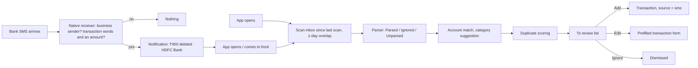

# SMS import (beta): plan

Status: phase 1 (beta) is built; see `mobile/AGENTS.md` → SMS import for how the code fits together. Phases 2 and 3
are still proposals. Revised after studying ten open-source apps and libraries
that already do this (see [Prior art](#prior-art-what-we-take-and-what-we-dont)).

## Goal

When a bank, card or wallet SMS arrives, SpendTrak notices it, reads the amount, account and merchant, and offers it
as a transaction. The user confirms it with one tap, edits it, or ignores it. Nothing is added without the user's
say-so (unless they turn on automatic adding for confident matches), and no message leaves the phone unless the user
reports one, redacted.

Android only. iPhones don't let apps read SMS; the web app receives the confirmed transactions through Google Drive
sync like any other.

## Decisions so far

| Topic | Decision |
|---|---|
| Label | Beta, off by default, turned on from Settings with a clear explanation first |
| Detection | Real time: a notification as soon as a bank SMS arrives, plus a scan of the inbox whenever the app opens as a safety net |
| Adding | Review first. Optional "Add confident ones automatically" (off in the beta), with Undo |
| Improving the parser | "Report a message we got wrong": a redacted copy, sent only after the user sees and confirms it |
| Learning | From what the user already does: account by last digits, category by merchant, ignored senders |
| Parser | SpendTrak's own TypeScript parser (not `transaction-sms-parser`, see below), built from the best ideas and permissively licensed data in the prior art |

## What changed after studying the prior art

- **Android 15 blocks the SMS permission for apps installed from outside a store.** SpendTrak's APK comes from
  GitHub, so on Android 15 and later the first request fails with "App was denied access to SMS". The user has to
  open App info, tap ⋮, choose *Allow restricted settings*, then grant SMS. (On Android 13 and 14 the same applies
  to notification access, which matters for phase 2.) The setup flow detects this and walks people through it,
  otherwise most users couldn't turn the feature on at all. AutoSpend ships a similar help screen.
- **Hard evidence of a payment overrides every filter.** A registered bank sender, a 12-digit UPI reference (RRN or
  UTR) and a word like "debited" or "credited" together mean money moved. No rejection rule may drop such a message.
  UPITracker learned this when its filters silently dropped two banks' formats (12 real transactions) on a real
  inbox, despite perfect scores on its training data.
- **Our own parser, not `transaction-sms-parser`.**
  - It has no test messages in its repo, so its bank coverage can't be verified.
  - It doesn't reject OTPs, failed payments or "will be debited" notices.
  - It checks "debit" before "credit", so "refund credited to your debit card" comes out as a debit.
  - It's about 700 lines; writing our own with a proper test suite is less risk than patching it.
- **A generic parser first, bank templates second.** The two most mature apps (PennyWise with 178 banks and pckt)
  show two working routes: one class per bank, or one generic parser that's "strict about *what* is a transaction,
  lenient about *how* it's phrased". We start generic and add small data-only templates (anchor text, no code) for
  banks it gets wrong.
- **Three outcomes, not two.** Every message ends up *Parsed*, *Ignored* (with a reason, such as OTP or failed) or
  *Unparsed* (looks financial, but couldn't be read). Unparsed messages are kept briefly, so a parser update can
  retry them without reading the inbox again.
- **Duplicates are scored, not just matched.** Signals add up to a score, with one threshold to merge automatically
  and a lower one to ask the user (pckt's design).
  - Banks often send the same SMS from several sender IDs (`JD-PHONPE-S`, `VA-PHONPE-S`), so the message key comes
    from the reference, or else the text, never the sender.
  - The balance after each payment keeps genuinely repeated payments apart, such as four identical wallet debits in
    a row (both ideas from UPITracker).
- **A transparency screen.** Every bank message SpendTrak looked at, with what happened and why. All the mature apps
  have one; it's essential for a beta.
- **Phone-maker settings help.** Xiaomi, Oppo, Vivo and others can stop apps from receiving SMS in the background.
  A checklist with links to the right settings (PennyWise's pattern) makes real-time alerts dependable.
- **UPI apps' notifications are a second source.** Many UPI payments never produce a bank SMS, or the SMS lacks the
  merchant name. Reading payment apps' notifications (Aspend) closes that gap. This is planned for phase 2.
- **No machine learning in phase 1.** Rules plus real test messages are more reliable for now.
  - Expense_tracker's classifier was trained only on synthetic, template-generated messages and never tested on real
    ones.
  - UPITracker's three small classifiers, trained on about 380 real UPI messages, still needed the evidence override
    above to stop dropping real payments.

  A small classifier could come later, as a second opinion that never overrules hard evidence, if real labelled data
  builds up through reports.
- **SMS data stays out of Android's cloud backup, and out of logs.** UPITracker excludes its database from backup;
  AutoSpend prints full messages to the device log. SpendTrak keeps SMS data in its own database file, excluded from
  backup, and never logs message text.

## Rules and constraints

- **Distribution.** SpendTrak ships as an APK on GitHub, so SMS permissions need no Google approval today.
- **If SpendTrak moves to Google Play,** SMS access needs a declared exception for "SMS-based money management".
  Play also forbids sending non-financial or personal SMS off the phone, and requires a privacy policy plus a
  prominent disclosure before the permission prompt. This design meets those rules.
- **Restricted settings (Android 13 and later).** For apps installed from a browser or file manager, Android 15
  restricts the SMS permission, and Android 13 and 14 restrict notification access. The user must allow restricted
  settings in App info first. Installs through the Play Store or other stores that use Android's installer API
  aren't affected.
- **Privacy promise.** SpendTrak has no server and tracks nothing. Messages are read and parsed on the phone.
  - Raw SMS text is kept only while needed: until the user acts on a parsed item, or up to 30 days for an
    unparsed one. Ignored messages keep only a hash and the reason.
  - The native receiver stores nothing. One prior-art app keeps a queue of full SMS bodies in plain shared
    preferences; we don't.
  - Only confirmed transactions sync to Google Drive.
  - SMS data stays out of Android's cloud backup and device transfer. No separate database file is needed: the
    app's backup rules (from expo-secure-store) include only shared preferences, so no database is backed up.
  - Message text never goes to the device log, in Kotlin or JavaScript; only lengths and outcomes do.
- **India's DPDP Act 2023.** No message data is collected, so SpendTrak doesn't become a data processor for it.
  Reports are redacted and sent only with explicit consent each time.
- **Licences.** SpendTrak has no open-source licence. So code from GPL or AGPL projects (PennyWise, Cashiro, pckt),
  and from projects with no licence at all (UPITracker), must not be copied: not their code, regexes, keyword lists,
  data or test messages. Their ideas and designs are fair to learn from. MIT and Apache-2.0 material could be reused
  with attribution; in the end phase 1 copies no third-party code or data (the parser, keyword lists and fixtures
  are SpendTrak's own), so no notices file is needed yet.

## How it works



### 1. Native part (Kotlin, small local Expo module)

A local module in `mobile/modules/sms-reader`, autolinked, with its permissions and receiver declared in its own
`AndroidManifest.xml`.

- **Permissions:** `READ_SMS` and `RECEIVE_SMS`, one system dialog. They're requested only after the user turns the
  feature on and reads the explanation.
  - If Android refuses without showing the dialog (restricted settings, Android 15 and later), the app shows a
    three-step guide with a button that opens SpendTrak's App info: tap ⋮, choose *Allow restricted settings*, then
    allow SMS.
  - When the user returns, the app checks the permission again by itself.
  - The guide mentions that steps differ slightly by phone maker.
- **`readInbox(sinceMs, limit)`:** queries `Telephony.Sms.Inbox` for `_id`, `address`, `body` and `date`, oldest
  first.
  - It filters in Kotlin, so personal chats never reach JavaScript. Only business senders are returned: the DLT
    format `XX-NAME` with an optional `-S`, `-T` or `-G` suffix, or other alphanumeric IDs, never phone numbers.
  - Promotional senders (`-P`) are dropped there too.
- **`SmsReceiver`:** a manifest-declared receiver for `SMS_RECEIVED`. Android exempts this broadcast, so it fires
  even when the app is closed. It runs only if the feature is on (a flag JavaScript writes to shared preferences),
  then:
  1. Merges multi-part messages.
  2. Checks the sender is a business sender, and the text has a transaction word and an amount.
  3. Posts a notification: "₹450.00 debited · HDFC Bank. Tap to review."
     - On the lock screen, it uses private visibility: "New bank transaction".
     - It has its own channel, "Bank messages".
  4. A tap deep-links to `spendtrak://sms-review`.

  It writes no data, so the full parse happens only in JavaScript (the pckt design).
- **No background parsing or polling.** The inbox scan when the app opens catches everything, including anything
  the receiver missed on phones that restrict background apps.
- **Each scan** reads from the last scan time minus one day; the overlap is free because messages are de-duplicated
  by ID.

### 2. Parser (TypeScript, pure, tested)

`mobile/src/lib/sms/`, kept free of native imports so `node:test` runs it like the existing tests. Amounts are whole
paise (integers), never floating point.

```ts
type SmsParseResult =
  | { kind: 'parsed'; txn: ParsedSms; confidence: number }   // 0–1
  | { kind: 'ignored'; reason: IgnoreReason }                // terminal
  | { kind: 'unparsed'; reason: 'no-amount' | 'no-direction' | 'ambiguous' }; // retried after parser updates
```

1. **Sender:** parse the DLT header (`VM-HDFCBK-S` gives the code `HDFCBK` and the suffix `S`), then look the code up
   in an institution registry (`HDFCBK` and `HDFCCC` map to HDFC Bank, `SBIUPI` to SBI, and so on). Unknown business
   senders still parse, but at lower confidence.
2. **Hard evidence check:** a registered sender plus a 12-digit RRN, UTR or UPI reference plus a settlement word
   (debited, credited, sent, received, paid) marks the message as *settled*. Settled messages skip the rejection
   rules below, apart from "failed" (see the second note after the table).
3. **Reject (Ignored, with a reason):**

   | Reason | Examples |
   |---|---|
   | OTP or verification | "OTP for transaction", "verification code" |
   | Future or scheduled debit | "will be debited", mandate or autopay intimation, "scheduled for" |
   | Mandate setup | "mandate created", "AutoPay set up" (but the execution "debited via mandate" is a real debit) |
   | Payment request | "has requested money", UPI collect request |
   | Failed | failed, declined, unsuccessful, insufficient funds (a completed reversal is not failed) |
   | Fund block | IPO "ASBA" block, amount blocked |
   | Bill or statement | statement generated, minimum amount due, due date reminder (unless a payment verb is also present) |
   | Offer or promotion | EMI conversion offer, loan or limit offers, cashback offers, vouchers, rewards points, rummy or betting ads |
   | Scam or phishing | KYC update links, prizes, "enter your UPI PIN to receive", APK links |
   | Balance only | balance enquiry replies (kept for the balance check in phase 2) |

   - Rules match phrases, not single words. A blocklist of words like "Loan", "Code" or "Win" (AutoSpend's approach)
     would also drop real alerts such as "Loan EMI of Rs 5,000 debited".
   - A settled message that also says "failed" or "reversed" is still checked. Banks do send "failed, amount will
     be reversed" with a reference number.

4. **Pick the transaction clause:** split the message into clauses and find the one with the transaction verb. Then
   choose the amount closest to that verb, penalising numbers next to "bal", "limit" or "available", so the balance
   or credit limit isn't taken for the amount (from Aspend and Expense_tracker).
5. **Extract:** amount, direction (refund or reversal always means credit), account or card last digits (rejecting
   years and amounts that look like them), mode (UPI, card, ATM, NEFT, IMPS, RTGS, wallet, net banking), UPI VPA,
   merchant or counterparty, reference (UPI ref, RRN or UTR), available balance and date. Use the date in the text
   when present, otherwise the SMS time.
6. **Merchant cleanup:**
   - Strip prefixes (`UPI/`, `POS`), legal suffixes (`PVT LTD`) and trailing reference numbers.
   - Map payment-gateway and legal names to brands (`BUNDL` to Swiggy, `ETERNAL` to Zomato, `ONE97` to Paytm, `AMZN`
     to Amazon).
   - Mark person-to-person UPI payments; card and ATM payments are never to a person.
7. **Bank templates (data only):** for formats the generic rules get wrong, a JSON template gives the sender code and
   the literal text before and after each field (the idea from `sms-transaction-parser`). Templates carry a
   `revision`; adding a bank format needs no code.
8. **Confidence:** additive signals.
   - Plus points for a known institution, a reference, an account hint and a merchant.
   - A penalty when none of sender, account and reference are known.
   - *Ready* (≥ 0.7) can be added with one tap; below that it's flagged *needs a look*.
9. **Parser version:** a `SMS_PARSER_VERSION` constant. When it increases, stored Unparsed messages are parsed again
   once (pckt's pattern), so a fix reaches them without reading the inbox again.

### 3. Turning a parsed SMS into a SpendTrak transaction

| Message | Becomes |
|---|---|
| Debit, card spend, UPI sent | Expense |
| Credit, salary, UPI received | Income |
| Refund or reversal | Income (category "Refund") |
| ATM withdrawal | Transfer to the Cash account (asked once which account is "Cash") |
| Credit card bill payment (debit from bank, "payment received" on the card) | Card bill payment, using the existing pay-bill flow |
| Debit from one own account plus an opposite credit of the same amount to another within an hour | One transfer (phase 2) |

### 4. Learning from what the user does

All of this is stored locally.

| Learns | From | Stored as |
|---|---|---|
| Which account "HDFC ••1234" is | The first time the account picker is used for that institution and those digits | `sms_account_hints (institution, last digits) → account_id`. Two- and three-digit masks merge with the four-digit one for the same bank (PennyWise's pattern) |
| Category for a merchant | The category chosen when a merchant's transaction is added or edited | `merchant_categories (merchant_key) → category_id, subcategory_id`, checked before any built-in keywords |
| Senders to ignore | "Ignore messages from this sender" | Ignored sender codes in settings |

Built-in category suggestions for unknown merchants come from a keyword map (food, transport, shopping, bills and so
on), seeded from Aspend's MIT-licensed map and adjusted to SpendTrak's categories.

### 5. Duplicates

- **Same message again** (receiver plus scan, a rescan, dual SIM, or the same text from several sender IDs such as
  `JD-PHONPE-S` and `VA-PHONPE-S`): skipped by SMS `_id`, then by a message key.
  - The key is `ref:<reference>` when the message has one, otherwise `body:<normalised text>` (letters and digits
    only, lowercased).
  - The sender is deliberately left out, and so is the time.
- **The same payment reported twice** (bank plus UPI app, or later bank plus notification): a score from these
  signals.

  | Signal | Effect |
  |---|---|
  | Same UPI ref, RRN or UTR | Certain match |
  | Different references on both | Certain non-match |
  | Same amount and direction | Required to compare at all |
  | Same account digits / different | Plus / large minus |
  | Time gap (≤5 min … ≤24 h) | Plus, falling with time |
  | Merchant words overlap / none | Plus / minus |
  | Balance after the payment equal / different (when both show one) | Certain match / certain non-match (keeps four identical wallet payments in a row apart) |
  | Exact time in the text equal / different (when both show seconds) | Certain match / certain non-match |
  | Same institution already reported this exact amount, with different wording or reference | Minus (banks don't repeat themselves, so it's probably two real payments, like two ₹20 teas) |

  At ≥ 0.75 the item is merged quietly, with the original kept as evidence. Between 0.5 and 0.75 it shows as
  "Possible duplicate" with *Keep both* or *Merge*.
- **Already logged by hand:** a manual transaction with the same amount and account, dated within a day, shows
  "Looks already added" and offers to link it instead.
- **Database guarantee:** confirmed items are saved with `source = 'sms'` and `source_ref` set to the message key.
  The existing unique index on `(source, source_ref)` means a message can't create two transactions.

### 6. Screens

**Home:** a "3 bank transactions to review" card when anything is waiting.

**To review** (`/sms-review`):

- **Each item shows:**
  - Direction and amount.
  - Merchant or payee.
  - Account, or "Choose account" the first time.
  - Date and time, and the mode (UPI, card and so on).
  - Suggested category.
  - The original SMS, collapsed.
- **Actions:**
  - *Add:* one tap when the item is ready.
  - *Edit:* the prefilled form.
  - *Ignore,* with "Ignore messages from this sender" in a menu.
  - *Report.*
- **"Add all ready"** confirms everything that needs nothing more.
- **Possible duplicates** show *Keep both* or *Merge*.
- **Unparsed messages** are grouped at the bottom ("Couldn't read these"), with *Enter manually* and *Report*.

**Settings → SMS import (Beta):**

- **On/off,** with an explanation first:
  - What's read: business senders only.
  - What happens: it's parsed on the phone, nothing is uploaded, and raw text is deleted after review.
  - How to turn it off and delete its data.

  Then the permission prompt, and the restricted-settings guide if Android blocks it.
- **Import past messages:** 1, 3 or 6 months, offered once when the feature is first turned on. If little history
  turns up, the review list offers "Look further back".
- **Notify me when a bank SMS arrives** (on by default).
- **Add confident ones automatically** (off by default in the beta). Auto-added items appear in the list as
  *Added*, with Undo for 24 hours.
- **Messages SpendTrak looked at:** the transparency screen. Each bank message shows *Added*, *Waiting*,
  *Ignored: OTP*, *Couldn't read* and so on, with a tap to see the text and report it.
- **Remembered accounts and merchants,** and **ignored senders:** review, edit or forget each one.
- **Make alerts reliable on this phone:** a checklist for Xiaomi, Redmi, POCO, Oppo, Vivo, Realme, OnePlus and
  Samsung.
  - Allow "Notification SMS" (Xiaomi), allow autostart, and set battery to unrestricted.
  - Each item links to the right system screen, falling back to App info.
- **Clear SMS import data.**

### 7. Reporting a message we got wrong

From any item, or from the transparency screen: *Report this message*.

1. **Redact automatically:**

   | Replaced | With |
   |---|---|
   | Amounts | `{amount}` |
   | Account and card digits | `{acct}` |
   | Dates and times | `{date}`, `{time}` |
   | References and balances | `{ref}`, `{balance}` |
   | UPI IDs | `{vpa}` |
   | Phone numbers | `{phone}` |
   | Names after "to", "from", "by" or "Info:" | `{payee}` |

   The bank's sender code is kept, because it identifies the format, not the person.
2. **Show it:** the user sees exactly what will be sent, can edit it, and can add what went wrong ("this was a
   refund", "wrong amount").
3. **Send** through the existing EmailJS feedback channel with a separate template, or *Copy* it to paste into a
   GitHub issue. Every fixed report becomes a test message in the repo.

PennyWise sends the raw SMS plus an encrypted device ID to its own server. We deliberately don't, to keep the "no
server" promise.

### 8. Data

New device-only tables in the main database (no change tracking), left out of SpendTrak's backups and Drive sync
because they describe this phone's inbox: `sms_messages`, `sms_account_hints`, `merchant_categories` and `sms_state`
(scan progress). Confirmed transactions are ordinary transactions with `source = 'sms'`.

- **`sms_messages`:**
  - `id`, `sms_id`, `msg_key` (unique: reference or normalised text), `sender`, `received_at`.
  - `body`: kept only while pending, or up to 30 days when unparsed.
  - `result` (parsed, ignored or unparsed), `reason`, `parsed` (JSON), `confidence`, `parser_version`.
  - `status` (pending, added, auto-added, ignored, duplicate or merged), `transaction_id` and `updated_at`.
- **`sms_account_hints`** and **`merchant_categories`,** as above.

New settings (device-only): `smsImportEnabled`, `smsNotify`, `smsAutoAdd` and `smsIgnoredSenders`. The last scan
time, first-import start and parser version live in `sms_state`, so frequent scans don't touch the settings table.

## Phases

### Phase 1: beta (1.9.0)

- The native module: permissions with the restricted-settings guide, inbox read, and the real-time receiver with
  its notification.
- The parser: sender registry, the hard-evidence override, rejection rules, clause and amount selection, extraction, merchant cleanup,
  confidence, and Parsed, Ignored and Unparsed outcomes with parser-version retries.
- Bank templates, used only where the generic parser fails on the sample messages.
- The review list, the Home card, the Settings page with its explanation, and the transparency screen.
- Account matching, merchant-to-category memory and scored duplicates.
- Reporting with redaction.
- The phone-maker settings checklist.
- Optional automatic adding (off) with Undo.

### Phase 2

- **UPI app notifications as a second source:** a `NotificationListenerService` for payment and bank apps, filtered
  by package name and chosen by the user.
  - **Payment apps:** GPay, PhonePe, Paytm, BHIM, CRED, Amazon Pay and so on.
  - **Bank apps:** SBI YONO, HDFC, ICICI iMobile, Axis and so on.
  - **What it adds:** payments with no SMS, and better merchant names. Duplicate scoring gets a "different channel"
    bonus.
  - **Android 13 and later:** notification access is a restricted setting for apps not installed from a store, so
    it reuses the same guide.
  - **Android 15:** OTP notifications are hidden from apps like this, which suits us.
- **Transfers between own accounts:** both legs detected and linked, so they don't count as spending and income.
- **Card bill payments:** paired across the bank SMS and the card SMS.
- **Balance check:** the available balance in the SMS is compared with SpendTrak's balance for that account, and
  the app offers to fix the difference.
- **Repeat charges:** the same merchant and amount every month suggests a *planned payment* (SpendTrak already has
  planned payments).
- **Notification actions:** *Add* or *Ignore* without opening the app, for ready items. This needs the parser to run
  in the background (headless JS) or a small Kotlin version.

### Phase 3

- **Teach a format:** for an unparsed message, the user taps the amount, merchant and account. SpendTrak saves an
  anchor template for that sender, which only matches later messages that fit it exactly, and still asks before
  adding until one has been confirmed (PennyWise's approach).
- **Templates downloaded from GitHub** (data only), so new bank formats ship without an app update.
- **Optionally, a small on-device classifier** as a second opinion on "is this a transaction?". It could be
  FastText-style (about 170 KB, the Apache-2.0 design from Expense_tracker), or TF-IDF plus logistic regression
  (UPITracker's three-stage idea: spam, then transaction, then direction, about 340 KB).
  - It must never drop a message with hard evidence of payment.
  - It falls back to rules if the model fails to load.
  - It's tested on messages it wasn't trained on, from a real inbox.
  - It's only worth it once enough real, reported messages exist to train and test it.

Not planned: an LLM fallback (it needs either a server or a large on-device model), and reading bank emails (Gmail's
read scope requires a paid security assessment for public apps).

## Testing

- **Fixtures as data:** `mobile/src/lib/sms/__fixtures__/*.json`, one file per institution. Each case is
  `{ name, sender, body, timestamp, expected }` or `{ ..., expectedIgnored: reason }` (the format
  `sms-transaction-parser` uses).
  - Every bank format gets at least three variants: spacing, line breaks and wording.
  - Every rejection reason has its own cases.
- **Unit tests** (`node:test`): the parser against every fixture, plus redaction, duplicate scoring, merchant
  cleanup, account-digit merging and template matching.
- **Rule for parser changes:** every fix comes with a new fixture and an increased `SMS_PARSER_VERSION`.
- **Emulator:** the emulator console can deliver fake incoming SMS. That tests the receiver, the notification, the
  deep link and the review flow end to end.
- **Real phones:** a beta on your phone and a few friends' phones, on different banks and phone makers (include a
  Xiaomi). The report button then fills the gaps.

## Prior art: what we take and what we don't

| Project | Licence | Take | Leave |
|---|---|---|---|
| [Aspend](https://github.com/sthrnilshaaa/Aspend) | MIT | Promotional, OTP and failure keyword lists; amount picked by nearness to the verb; category keyword map; the notification-listener idea and its duplicate checks | Static-only categories, auto-adding without review |
| [transaction_sms_parser](https://github.com/MabudAlam/transaction_sms_parser) (Dart) | MIT | UPI handle list (50, to extend), bank names, wallets, card scheme keywords | Its parser (v0.0.1, no tests, no rejection rules) |
| [transaction-sms-parser](https://github.com/saurabhgupta050890/transaction-sms-parser) (TS) | MIT | Nothing essential | As a dependency: no fixtures, no rejection, debit-first bug |
| [sms-transaction-parser](https://github.com/peteretelej/sms-transaction-parser) (Kotlin) | Apache-2.0 | The design: anchor templates as data, the typed result with failure reasons, amounts in minor units, the fixture format, the contribution checklist | Its templates (Kenya only) and its build (JVM only, no JS) |
| [Expense_tracker](https://github.com/allwin-antony/Expense_tracker) | Apache-2.0 | Scam/phishing rejection category; clause scoping before extraction; notification actions; the FastText design for later | Its accuracy claims (synthetic data only), its plain-text SMS queue |
| [PennyWise AI](https://github.com/sarim2000/pennywiseai-tracker) | AGPL-3.0 | Ideas only: the rejection classes (fund blocks, EMI offers), duplicate matching on UPI refs, merging account digits, teach-a-template, the phone-maker checklist, the balance check | All code, regexes, keyword lists and test messages; sending raw SMS to a server |
| [Cashiro](https://github.com/ritesh-kanwar/Cashiro) | AGPL-3.0 | Nothing beyond PennyWise (it's an earlier fork) | All code |
| [UPITracker](https://github.com/rohansen856/UPITracker) | None (all rights reserved) | Ideas only: the hard-evidence override, duplicate keys without the sender, balance-after and exact-time signals, the payment and bank app package lists for notifications, excluding SMS data from backup, the three-stage classifier design and its lesson about real inboxes | All code, data and models |
| [AutoSpend](https://github.com/GaganHR2006/AutoSpend-Tracker) | MIT (stated in the README; no licence file) | The idea of a restricted-settings help screen; rummy and betting promotions | Its single-word blocklist (drops real alerts), logging full messages |
| [pckt](https://github.com/pritam-ravani/pckt) | GPL-3.0 | Ideas only: generic "strict about what, lenient about how" rules, the native receiver that only notifies, Parsed/Ignored/Unparsed outcomes, parser-version retries, the duplicate score table, brand aliases, self-transfer detection, the transparency screen | All code, regexes, keyword lists and test messages |

## Risks and open questions

- **Format variety** is still the main risk. Mitigations: the sender registry, real samples as fixtures, bank
  templates, the report button and the transparency screen.
- **UPI merchants** often appear only as a payment ID (`paytmqr2810...@paytm`), so names and categories are weak
  until the user names them once, or until phase 2 brings the UPI app's notification with the real merchant name.
- **RCS business messages:** some banks are moving alerts to Google Messages' RCS. Those don't appear in the SMS
  inbox, and no app can read them. Phase 2's notification listener can see them as Messages notifications.
- **Restricted settings friction:** on Android 15 and later, every GitHub install needs the extra *Allow restricted
  settings* step before SMS access. The guide makes it manageable. A Play Store listing would remove it, but needs
  Google's SMS declaration.
- **Phone makers** can block the receiver or hide bank messages. The checklist plus the scan on every app open cover
  this.
- **Notification permission:** on Android 13 and later, real-time alerts need notification permission. It's already
  requested for reminders; SMS import asks only if it isn't granted yet.
- **Unencrypted database:** SpendTrak's SQLite file isn't encrypted (pckt uses SQLCipher). Keeping raw SMS text only
  briefly limits the exposure. Full database encryption is a separate decision for the whole app.

## What's needed before building

**30 to 50 real messages,** with names changed and account numbers cut to the last 4 digits, each with its sender ID.
Cover your banks and cards:

- **Everyday:** debits, credits, UPI sent and received, card spends.
- **Less common:** ATM withdrawals, NEFT and IMPS, salary, refunds and card bill payments.
- **Messages that must be ignored:** failed payments, "will be debited" or AutoPay notices, IPO blocks, due
  reminders, OTPs, offers and promotions.

Send them in chat or paste them into a text file. They become the parser's first fixtures.
